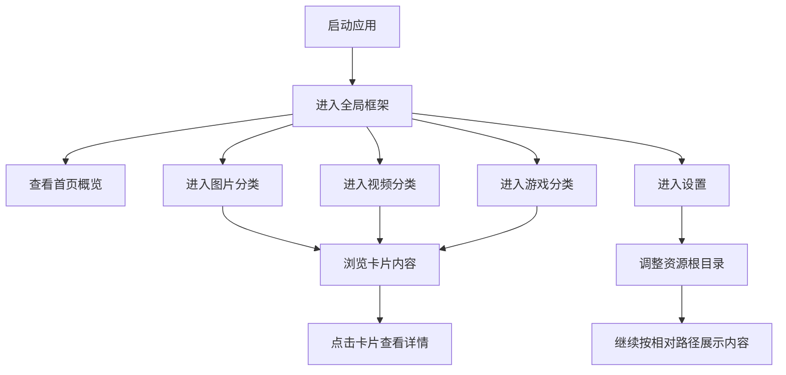

## 1. 产品概述
这是一个可迁移的本地多媒体资源索引桌面应用，面向图片、视频、游戏三类内容，重点解决“资源按既定目录存放后仍可被统一查看与定位”的问题。
- 应用本身不依赖单台电脑，支持将应用与资源目录一起交付给他人使用，并通过相对路径和应用内设置适配不同机器上的存放位置。
- 当前阶段只聚焦桌面端基础框架、主导航结构、内容展示区和详情承接位，不展开底层扩展设计。

## 2. 核心功能

### 2.1 功能模块
1. **首页**：应用入口、分类概览、使用说明入口、路径状态提示。
2. **图片分类页**：图片卡片流展示、点击查看详细信息。
3. **视频分类页**：视频缩略卡片展示、点击查看详细信息。
4. **游戏分类页**：游戏封面卡片展示、点击查看详细信息。
5. **设置**：资源根目录调整、相对路径策略说明、Logo 资源配置入口。

### 2.2 页面明细
| 页面名称 | 模块名称 | 功能描述 |
|-----------|-----------|-----------|
| 全局框架 | 左侧导航栏 | 固定展示 Logo、首页、图片、视频、游戏，底部保留设置入口 |
| 全局框架 | 顶部标题区 | 展示当前分类标题、路径状态占位、后续搜索入口占位 |
| 首页 | 概览区 | 显示分类入口、当前框架说明、可迁移使用提示 |
| 图片分类页 | 内容展示区 | 以图片卡片阵列形式展示内容 |
| 视频分类页 | 内容展示区 | 以视频缩略卡片阵列形式展示内容 |
| 游戏分类页 | 内容展示区 | 以游戏封面卡片阵列形式展示内容 |
| 全局框架 | 详情承接位 | 点击卡片后查看详细信息，当前阶段只保留承接结构 |
| 设置 | 资源路径设置 | 调整资源根目录、处理相对路径基准位置 |

## 3. 核心流程
用户启动应用后，从左侧导航进入首页或任一分类页面；右侧展示区统一以卡片流方式展示内容；点击卡片进入详情承接区查看详细信息；当应用迁移到其他电脑时，用户可在设置中调整资源根目录，使内容继续按相对路径被识别和展示。

## 4. 用户界面设计
### 4.1 设计风格
- 主色调：深色后台式界面，突出内容展示区
- 辅助色：中性灰 + 低饱和强调色，用于选中状态和分类高亮
- 按钮风格：简洁、扁平、轻圆角
- 字体：优先清晰稳定的桌面端中文界面字体
- 布局风格：左侧固定导航，右侧内容管理面板
- 图标风格：简洁线性图标，突出“管理台”感

### 4.2 页面设计概览
| 页面名称 | 模块名称 | UI 元素 |
|-----------|-----------|-----------|
| 全局框架 | 左侧导航栏 | Logo、菜单项、选中高亮、设置入口 |
| 全局框架 | 右侧内容区 | 页面标题、内容网格、状态占位 |
| 首页 | 概览卡片 | 分类入口、说明性文字、使用引导 |
| 分类页 | 卡片阵列 | 缩略图、标题、基础信息占位、状态标记 |
| 详情承接位 | 详情面板 | 预留封面、标题、备注、路径信息承接区 |
| 设置 | 路径面板 | 根目录配置、相对路径说明、Logo 配置提示 |

### 4.3 响应策略
- 以桌面端优先设计为准
- 左侧导航保持固定宽度
- 右侧内容区根据窗口宽度自适应卡片列数
- 后续如扩展移动端，仅保留展示层适配，不在当前版本范围内

## 5. 当前冻结范围
- 先只实现基础框架，不展开复杂详情设计
- 先只支持首页、图片、视频、游戏、设置五个一级入口
- 先只验证可迁移框架与相对路径适配思路
- Logo 使用用户提供图片，但当前提供的路径待确认后接入
