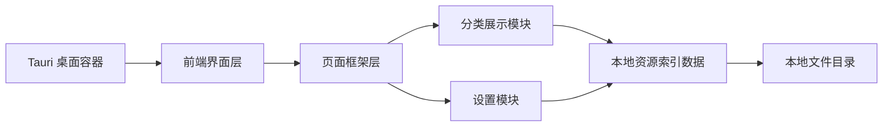

## 1. 架构设计

## 2. 技术说明
- 桌面框架：Tauri 2
- 前端：React 18 + TypeScript + Vite
- 样式：Tailwind CSS 3
- 路由：React Router
- 状态管理：先使用轻量本地状态方案，不引入复杂全局状态库
- 数据来源：当前阶段使用本地模拟数据驱动页面框架
- 资源路径策略：优先围绕相对路径与可调整根目录的思路设计前端结构

## 3. 路由定义
| 路由 | 用途 |
|-------|------|
| / | 首页 |
| /images | 图片分类页 |
| /videos | 视频分类页 |
| /games | 游戏分类页 |
| /settings | 设置页 |

## 4. 页面结构约定
- 使用统一的 `应用壳层` 包裹所有页面
- 左侧为固定导航栏，负责 Logo 和一级菜单
- 右侧为页面展示区，承接顶部栏、内容网格和详情区域占位
- 分类页面共享同一套卡片网格结构，仅替换数据源和标题
- 首页和设置页作为独立内容模块挂载在统一框架内

## 5. 实现边界
- 当前只搭建外部框架与静态展示骨架
- 当前不接入真实扫描逻辑和底层存储
- 当前不实现复杂详情交互，只保留详情承接结构
- 当前不实现自动路径修复，仅预留设置入口与文案说明

## 6. 已知待确认项
- Logo 文件路径 `D:\图片素材\PS-DEMO;ZeroCat.png` 当前无法直接读取，需要用户确认准确路径或文件名
- 资源根目录设置的具体交互暂不展开，只保留基础入口
